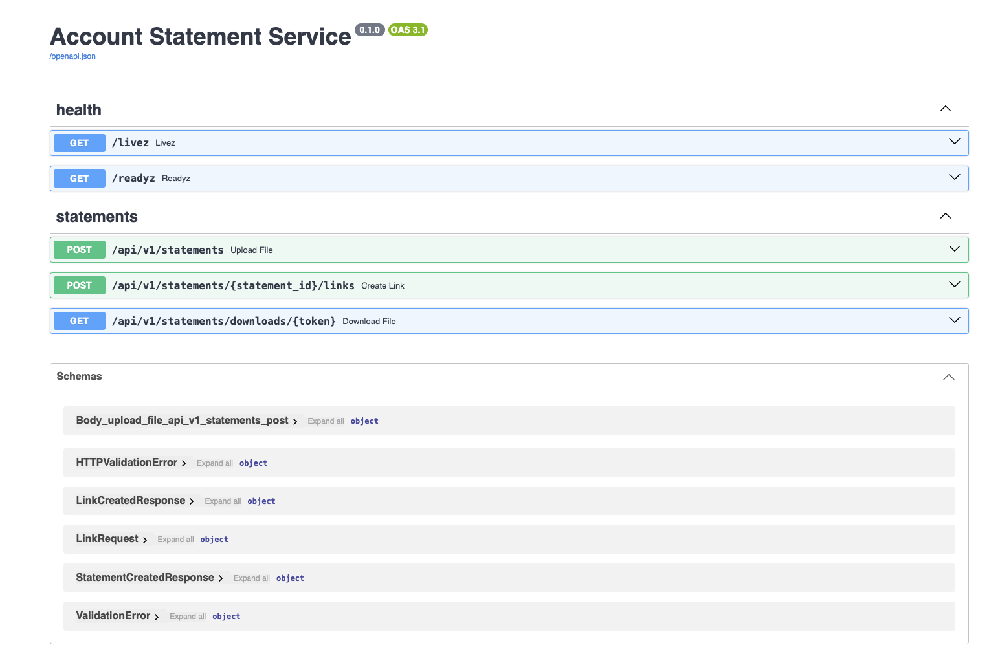

[](https://docs.python.org/3.13/)
[](https://github.com/pre-commit/pre-commit)
[](https://github.com/astral-sh/ruff)
[](https://github.com/astral-sh/uv)

# Account Statement Service (FastAPI + RustFS + Postgres)

This service stores customer account statements as PDF files and provides secure, time-limited download links to customers.


## How it works

```
(upstream service)
POST /api/v1/statements                        → The file is stored and a unique reference to the statement is returned

(upstream service)
POST /api/v1/statements/{statement_id}/links   → Returns a signed download link and the remaining validity period

(end user)
GET  /api/v1/statements/downloads/{token}.     → Downloads the file if the token is valid and not expired
```

### Security notes
- **Download URLs are bearer credentials.**  - the server keeps no
  per-link state, anyone with the link can download the file until it expires. TTLs should be kept short and links should be sent over HTTPS.
- **Ownership is only as strong as the API key.** - to limit damage from leaked keys, the `customer_id` is recorded for every uploaded file and link download creation succeeds only if the request names the same customer. An external customer authentication service can be used to verify the customer's identity before allowing link creation.

## Configuration

| Variable                     | Default                 | Notes                                                       |
|------------------------------|-------------------------|-------------------------------------------------------------|
| `API_KEY`                    | required (≥16 chars)    | Sent as `X-API-Key` on upload and link creation             |
| `LINK_SIGNING_KEY`           | required (≥32 chars)    | Rotating it invalidates every outstanding link              |
| `LINK_DEFAULT_TTL_SECONDS`   | `900`                   | Used when a link request has no `expires_in_seconds`        |
| `LINK_MAX_TTL_SECONDS`       | `86400`                 | Upper bound for `expires_in_seconds`                        |
| `MAX_UPLOAD_BYTES`           | `10485760` (10 MiB)     | Largest accepted upload; larger gets `413`                  |
| `PUBLIC_BASE_URL`            | `http://localhost:8000` | Prefix for generated links; must be reachable by end users  |
| `S3_ENDPOINT`                | `localhost:9000`        | `host:port` of the S3 API, no scheme                        |
| `S3_REGION`                  | `af-south-1`            | Signing region (AWS Africa, Cape Town)                      |
| `S3_ACCESS_KEY`              | `rustfsadmin`           |                                                             |
| `S3_SECRET_KEY`              | `rustfsadmin`           |                                                             |
| `S3_SECURE`                  | `false`                 | `true` for TLS to the S3 endpoint                           |
| `S3_BUCKET`                  | `downloads`             | Created on startup if missing                               |

Copy `.env.example` to `.env` for local runs.

## API

Interactive docs may be found at `/docs` when the service is running.




## Run locally via docker

Requires [uv](https://docs.astral.sh/uv/) and a RustFS server (see below for a quick one). uv installs
Python 3.13+ for you if it is not already available.

```bash
uv sync                  # creates .venv and installs runtime and dev dependencies from uv.lock

# quick RustFS for development. Use a named volume: the image runs as uid 10001,
# which cannot write to a root-owned host bind mount.
docker run -d --name rustfs -p 9000:9000 -p 9001:9001 \
  -e RUSTFS_ACCESS_KEY=rustfsadmin -e RUSTFS_SECRET_KEY=rustfsadmin \
  -v rustfs-data:/data rustfs/rustfs:1.0.4

export API_KEY=dev-api-key-0123456789 LINK_SIGNING_KEY=dev-signing-key-0123456789abcdef \
       S3_SECRET_KEY=rustfsadmin
uv run uvicorn service.server:create_app --factory --reload --port 8000

uv run pytest                           # unit tests (in-memory store)
S3_INTEGRATION=1 S3_SECRET_KEY=rustfsadmin uv run pytest   # also runs against the live RustFS
uv run ruff check .                     # lint

uv run pre-commit install               # once per clone: run the hooks in .pre-commit-config.yaml on each commit
uv run pre-commit run --all-files       # run them manually
```

## Container image

```bash
docker build -t fastapi-download:0.1.0 .
```

## Local image registry

The local registry is a `registry:2` container on the host, published at `localhost:5001` (override with
`REGISTRY_PORT`; 5000 is used by macOS AirPlay Receiver). Docker treats `localhost` as an insecure registry by default, so no daemon configuration is needed.

```bash
make registry-up                               # start the container (idempotent; kept across runs)
docker tag my-image:1.0 localhost:5001/my-image:1.0
docker push localhost:5001/my-image:1.0
curl -s localhost:5001/v2/_catalog            # list repositories
```

`make docker-build` builds the API image and pushes it there, and the app chart pulls from `localhost:5001`.
`make registry-down` removes the registry and its images.

## Local deploy with make

The `Makefile` wraps the steps below for a local cluster (default kube context `colima`).

```bash
make help              # list targets
make up                # start registry, build+push the API image, deploy RustFS + API
make forward           # API on :8000 (/docs), RustFS console on :9001
make status            # releases, pods, services, PVCs
make logs              # follow API logs
make down              # uninstall the API and RustFS (RustFS data is deleted with its PVC)
make purge             # also delete the namespace and .local/ secrets (asks first; CONFIRM=yes to skip)
```

Overrides: `make up KUBE_CONTEXT=rancher-desktop`, `RUSTFS_IMAGE_REPO=… RUSTFS_IMAGE_TAG=…`, `TIMEOUT=5m`.
Targets refuse any context that is not a local one (colima, rancher-desktop, docker-desktop, minikube, kind-*),
so they cannot touch remote clusters. Secrets are generated once and reused, so repeated `make up` runs keep
the same keys.

## Deploy with Helm

Both charts are local (`charts/`). Install RustFS first, then the API. Release names matter: the API's default
`s3.endpoint` (`rustfs:9000`) assumes the RustFS release is named `rustfs`.

```bash
NS=downloads
kubectl create namespace $NS

# 1. RustFS
helm upgrade --install rustfs charts/rustfs -n $NS \
  --set-string accessKey=rustfsadmin --set-string secretKey='<rustfs-secret-key>'

# 2. API. The S3 credentials must match step 1.
helm upgrade --install fastapi charts/account-statement-svc -n $NS \
  --set-string image.repository=fastapi-download --set-string image.tag=0.1.0 \
  --set-string apiKey="$(openssl rand -hex 24)" \
  --set-string linkSigningKey="$(openssl rand -hex 32)" \
  --set-string s3.accessKey=rustfsadmin --set-string s3.secretKey='<rustfs-secret-key>' \
  --set publicBaseUrl=http://localhost:8000
```

Notes:

- `apiKey` and `linkSigningKey` are required. Helm fails the render if they are missing. The API chart always
  creates its own Secret, `account-statement-svc-credentials`, with the keys `api-key`, `link-signing-key`,
  `s3-access-key` and `s3-secret-key`.
- The FastAPI image must be available to the cluster. On a local cluster such as Rancher Desktop or
  Colima, a local `docker build` is usually enough. Otherwise push it to a registry and set
  `image.repository`.
- For external access, set `ingress.enabled=true`, `ingress.host`, `ingress.className`, and
  `publicBaseUrl=https://<host>`. Links are built from `publicBaseUrl`, so it must match the address users
  reach.

Access locally without ingress:

```bash
kubectl -n $NS port-forward svc/account-statement-svc 8000:8000
kubectl -n $NS port-forward svc/rustfs 9001:9001       # RustFS console
```

Helm validation:

```bash
helm lint charts/rustfs
helm lint charts/account-statement-svc --set-string apiKey=x --set-string linkSigningKey=x
```
